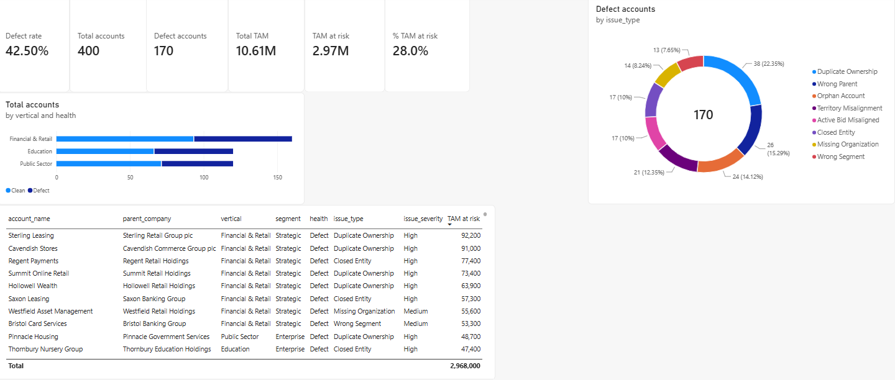
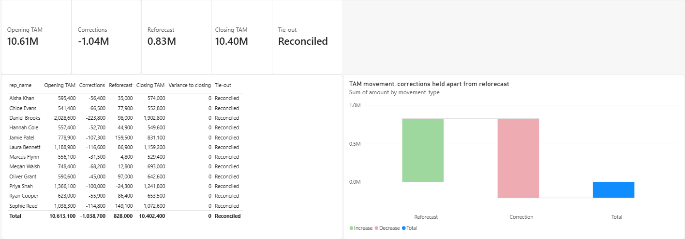
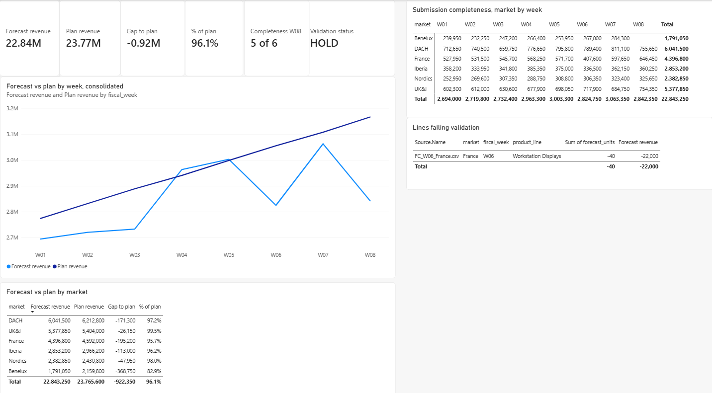
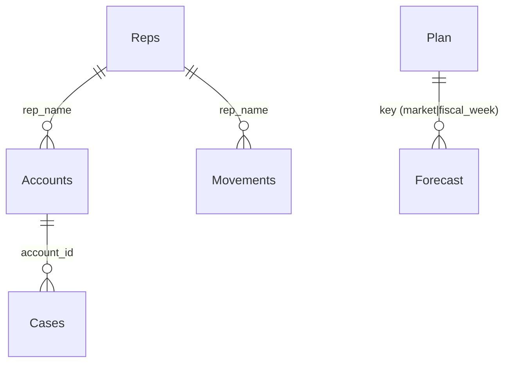

# UK & Ireland Coverage Audit, in Power BI

A three-page Power BI report that audits sales territory coverage the way a
planning analyst has to: every account carries its defect and the TAM sitting
on it, every TAM correction reconciles from opening to closing per rep, and a
weekly forecast cycle from six markets is consolidated, checked for
completeness and validated before it can be submitted.

Built in Power BI Desktop on generated data. There is no client or employer
information anywhere in this repository. The structure, the measures and the
reconciliation logic are the ones I use in territory planning work; the
numbers are invented so the model can be shown.

| | |
|---|---|
| Report file | `UKI_Coverage_Audit.pbix` (open in Power BI Desktop, free) |
| Model | 6 tables, 2 subject areas, single-direction relationships |
| Measures | 44 DAX measures documented with expected values in `dax/measures.dax`; the three pages draw on 26 of them |
| Power Query | 6 queries including a folder combine of 47 weekly files, in `powerquery/queries.m` |
| Data | regenerated by `scripts/generate_data.py`, documented in `docs/DATA_DICTIONARY.md` |
| Rebuild | step by step in `docs/BUILD_GUIDE.md` |

## The three pages

### 1. Account health



400 accounts, 170 carrying a defect, 42.5 percent. Total TAM 10.61M, of which
2.97M (28.0 percent) sits on a defective record. Defects by type on the donut,
health by vertical on the bar, and the account table sorted by TAM at risk so
the largest problem is at the top. A measure most sales managers ask for first,
live bids sitting on a defective record, is in the model as
`Misaligned with active bid`.

### 2. TAM reconciliation



Opening TAM by rep, 10,613,100. Corrections, which are data fixes (wrong parent,
closed entity, duplicate), minus 1,038,700. Reforecast, which is real change
(headcount moved in the filings), plus 828,000. Closing TAM 10,402,400. The
variance column reads zero for every rep and in total, and the Tie-out card
reads Reconciled.

The two movement types are kept apart on purpose. One delta per rep hides the
difference between a market that shrank and data that was wrong. Those are
different conversations and different actions, and a forecast line that mixes
them cannot be audited.

### 3. Forecast consolidation



Six markets submit a file each week. Power Query reads the folder, so
consolidation is a refresh, not a copy-paste. Forecast against plan by week and
by market, then two checks before anything is submitted:

- Completeness: a market-by-week grid with one blank cell. Benelux has not
  submitted week 8, so the card reads 5 of 6.
- Validation: one line in France's week 6 is negative, an entry error, listed
  in the exceptions table.

The status card reads HOLD until both are cleared. Drop the late Benelux file
into the folder and refresh: completeness goes to 6 of 6, the consolidated
number moves to 23.15M, and the status still holds on the France line.

## Model



Two subject areas that share no key, deliberately not joined. Coverage:
Accounts (400) is the fact table for territory health, Cases (260) for
governance, Movements (48) for the reconciliation, Reps (12) the dimension.
Forecast: Forecast (141 rows from 47 files) against Plan (48).

## What the measures do

The reconciliation chain on page 2, in order:

```
Opening TAM          = SUM ( Reps[current_tam] )
Corrections          = CALCULATE ( SUM ( Movements[amount] ), Movements[movement_type] = "Correction" )
Reforecast           = CALCULATE ( SUM ( Movements[amount] ), Movements[movement_type] = "Reforecast" )
Net movement         = SUM ( Movements[amount] )
Reconciled closing   = [Opening TAM] + [Net movement]
Closing TAM          = SUM ( Reps[corrected_tam] )
Variance to closing  = [Reconciled closing] - [Closing TAM]
Tie-out              = IF ( ABS ( [Variance to closing] ) < 1, "Reconciled", "BREAK" )
```

The gate on page 3:

```
Submissions expected = COUNTROWS ( Plan )
Submissions received = COUNTROWS ( SUMMARIZE ( Forecast, Forecast[market], Forecast[fiscal_week] ) )
Missing submissions  = [Submissions expected] - [Submissions received]
Negative lines       = CALCULATE ( COUNTROWS ( Forecast ), Forecast[forecast_units] < 0 )
Validation status    = IF ( [Missing submissions] = 0 && [Negative lines] = 0, "Ready to submit", "HOLD" )
```

All 44 measures, grouped by table with expected values, are in
[`dax/measures.dax`](dax/measures.dax).

## Power Query

Six queries. Typing on every column, a conditional column and a custom column
on Accounts, a custom key column on Forecast and Plan so the two join on
market and week, and a folder combine for the 47 forecast files. Every step is
in Applied Steps, so the refresh is repeatable and a new weekly file is picked
up without touching the query. The M is in
[`powerquery/queries.m`](powerquery/queries.m).

## Where this comes from

The method is the one I use for territory and TAM planning: size every account
from source, keep corrections apart from reforecast, reconcile opening to
closing before anything is committed, and run a governance queue where a case
closes only on a confirmed match. The same audit exists as a four-sheet Tableau
Public dashboard on the same generated data, and two companion repositories
apply the same method: `territory-coverage-capstone` runs this audit in Python
on the same generated figures, and `territory-restructure-sql` covers a
territory restructure in SQL on its own generated data:

- Tableau Public: UK & Ireland Coverage Audit
- `territory-coverage-capstone` (Python, the data model and analysis)
- `territory-restructure-sql` (SQL, the restructure logic)

## What is not built yet

Desktop only. The report is not published to the Power BI service, so there is
no scheduled refresh, no row-level security and no dataflow. Next in order:
row-level security by market on the forecast page, publishing to a workspace,
and a scheduled refresh on the submissions folder through a gateway.

## Rebuild it

```
git clone <this repository>
python scripts/generate_data.py          # optional, the data is committed
```

Then open `UKI_Coverage_Audit.pbix` and repoint the six Source steps at your
local `data/` folder (Transform data > each query > Source), or follow
`docs/BUILD_GUIDE.md` from a blank file.
